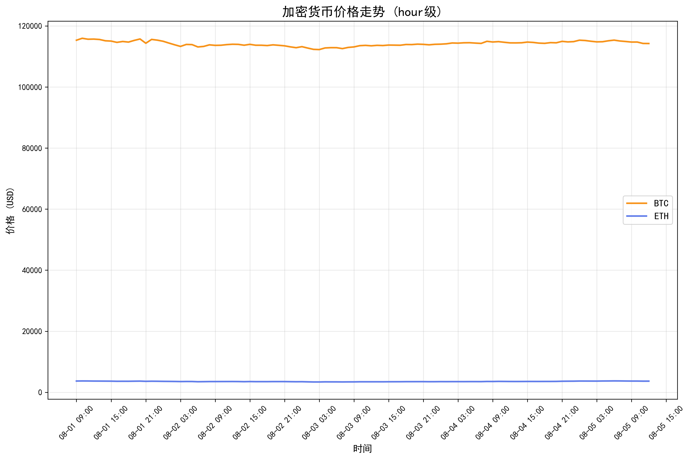
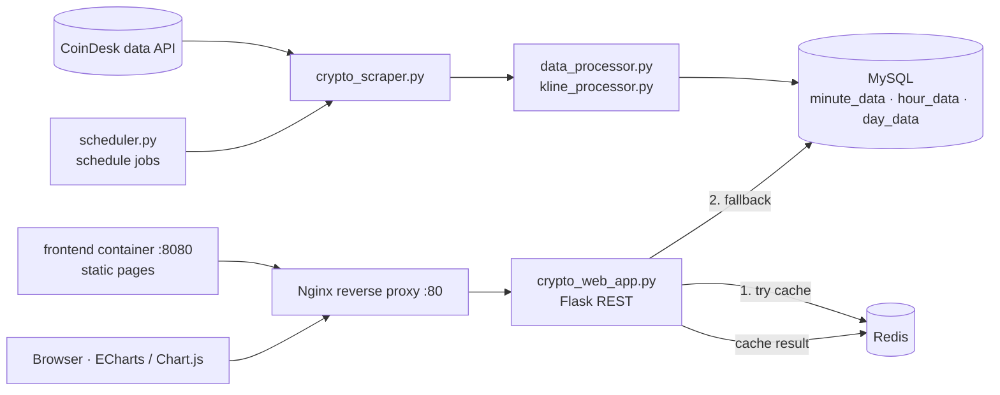

# Crypto Monitoring Plus

A BTC/ETH price-monitoring prototype. It collects prices from an external API, stores them at minute, hour and day granularity in MySQL, serves them through a Flask REST API with a Redis cache, and charts them in the browser. The whole stack runs under Docker Compose.


> **Context:** a personal learning prototype from my summer 2025 software-development internship, built with AI-assisted development under a project lead's guidance. It contains no company code or data.

<p align="center">
  
  <br><sub>Hourly BTC/ETH chart produced by <code>backend/crypto_analyzer.py</code> from collected data (Aug 2025).</sub>
</p>

## Architecture



## Highlights

- **Three storage granularities.** Separate `minute_data`, `hour_data` and `day_data` tables (`backend/crypto_db.py`), filled by scheduled collection and aggregation jobs (`backend/scheduler.py`).
- **Cache with graceful fallback.** The web app reads latest prices from Redis first, falls back to MySQL on a miss or a Redis error, and writes the result back to the cache (`backend/crypto_web_app.py`). If Redis is unavailable at startup, the app still runs without a cache.
- **Five-container Compose stack.** `mysql`, `redis`, `backend`, `frontend` and `nginx`, with health checks so the backend starts only after MySQL and Redis are healthy (`docker-compose.yml`).

## Tech Stack

Python · Flask 2.3 · mysql-connector-python · Redis 7 (redis-py) · pandas · NumPy · matplotlib · TA-Lib · schedule · MySQL 8 · Nginx · Docker Compose · HTML/CSS/JS with ECharts and Chart.js

## Getting Started

Requirements: Docker with Docker Compose.

```bash
git clone https://github.com/Willa1m/crypto-monitoring-plus.git
cd crypto-monitoring-plus
docker compose up -d --build
docker compose ps            # wait until mysql, redis and backend are healthy
curl http://localhost:8000/api/health
```

| Service | URL |
|---|---|
| Nginx (main entry) | <http://localhost> |
| Backend API | <http://localhost:8000/api/health> |
| Static frontend container | <http://localhost:8080> |

Routes served by `backend/crypto_web_app.py` (the process the backend container runs): pages `/`, `/bitcoin`, `/ethereum`, `/kline`; API `/api/health`, `/api/latest_prices`, `/api/chart_data`, `/api/btc_data`, `/api/eth_data`, `/api/kline_data`, `/api/refresh_charts`, `/api/cache/stats`, `/api/cache/clear`.

To run without Docker: `cd backend && pip install -r requirements.txt` (TA-Lib needs its C library first), provide MySQL and Redis, then run `bash start.sh`, which starts `scheduler.py` and `crypto_web_app.py`.

## Project Structure

```text
backend/
├── crypto_scraper.py       # price collection from the external API
├── crypto_db.py            # MySQL access, minute/hour/day tables
├── data_processor.py       # cleaning and aggregation
├── kline_processor.py      # candlestick (K-line) data
├── crypto_analyzer.py      # analysis report and charts
├── simple_redis_manager.py # cache helper
├── crypto_web_app.py       # Flask app: pages + REST API (run by the container)
├── app.py                  # alternative API-only Flask entry
├── scheduler.py            # periodic jobs
├── init.sql · Dockerfile · start.sh · requirements.txt
frontend/                   # static pages, JS, nginx-based container
nginx/                      # reverse-proxy image and config
docker-compose.yml
```

## Results / Learnings

- Brought up a multi-service stack end to end and learned to read container health checks and logs to find failures.
- Learned to treat the cache as optional: every Redis call has a database fallback, so a cache outage degrades speed, not correctness.
- Known gaps, as of this README: credentials are still hard-coded in the source and in `docker-compose.yml` and should move to environment variables; generated logs and `__pycache__` files are tracked in Git; there are no automated tests.

## 中文说明

这是我 2025 年夏季软件开发实习期间做的 BTC/ETH 行情监控学习原型：在项目负责人指导下，借助 AI 辅助开发完成，不含公司代码或数据。

主要做法：

- 从外部 API 采集行情，按分钟、小时、日三种粒度存入 MySQL；
- 用 Flask 提供 REST 接口；
- 读取时优先查 Redis 缓存，未命中或 Redis 出错时回退数据库，并把结果写回缓存；
- 前端用 ECharts / Chart.js 画图；
- 用 Docker Compose 编排 MySQL、Redis、后端、前端和 Nginx 五个容器。

已知不足：凭据仍写在代码和 compose 文件里，日志等生成文件被纳入了版本控制，也还没有自动化测试。
